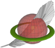

.. |doctest| replace:: :mod:`doctest`
.. |date| date:: %d-%m-%Y
.. |time| date:: %H:%M

.. |plugin| replace:: qgis-versioning plugin
.. _plugin: https://github.com/Oslandia/qgis-versioning

.. Images substitutions

.. _CC: http://creativecommons.org/licenses/by-sa/4.0

.. _spatialite-logo: https://www.gaia-gis.it/fossil/libspatialite/index
.. |postgis-logo| image:: images/PostGIS_logo.png
.. _postgis-logo: http://postgis.net/
